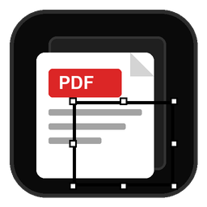

<div align="center">
  
  <h1>A-Crude-PDF-Editor (PDF Studio)</h1>
  <p>一款轻量、纯黑极简风格的可视化桌面 PDF 工具箱（Python 后端 + HTML5/Canvas 交互前端）</p>
  <p>
    <strong>简体中文</strong> | <a href="./README_EN.md">English</a>
  </p>
</div>

---

## ✨ 功能特性

### 1. 一体化「PDF & 图片合并」板块
* **混合自由合并**：将「多 PDF 合并」与「多图转 PDF」融为一体，支持纯 PDF 合并、纯图片转 PDF，以及 **PDF 与图片任意混排一键导出为新 PDF**。
* **方块网格 + 封面缩略图**：导入 PDF 时通过 Google PDFium 引擎实时渲染首页封面，导入图片时自动生成缩略图，以自适应方块卡片网格直观呈现顺序、页数与体积。
* **丝滑拖拽排序（Pointer Events + FLIP 动画）**：
  * 放弃迟钝的原生 HTML5 拖拽，采用跟手浮层 + 静态槽位无死区判定 + FLIP 平滑位移动画。
  * 按住任意方块卡片拖动时，其余卡片自动实时让位、序号徽章即时刷新；支持边缘自动滚动、按 `ESC` 键一键撤销拖拽，同时提供 `← 前移` / `后移 →` 与「按文件名升序」洗牌排序。
* **右下角高清大图预览**：每张方块缩略图右下角配有「预览」按钮，点击即可弹出全屏模态窗查看高清晰度大图、原始像素分辨率或 PDF 总页数（支持点击遮罩或按 `ESC` 关闭）。
* **灵活的图片排版参数**：支持保持原图尺寸、A4 纵向/横向、Letter 纸张规格，可自定义页边距（`0` / `5` / `10` / `20 mm`）与输出清晰度（`150` / `300 DPI`）。

### 2. 可视化交互「PDF 页面裁剪」板块
* **鼠标拉框自由交互**：基于 HTML5 Canvas，支持任意拉框新建选区、**8 个控制手柄**（四角与四边）精准拉伸、选区内整体拖拽平移，自带三分参考虚线与纯黑暗化遮罩。
* **比例锁定与快速去白边**：支持自由框选、`1:1`、`4:3`、`16:9`、`A4 纵向`、`A4 横向` 比例锁定，以及一键全页复位、一键裁去 `5%` / `10%` 边距。
* **实时尺寸读数与多页范围应用**：左侧 HUD 实时换算显示选区宽高（`pt` 与 `mm`），支持翻页跳转，可选择仅应用当前页、应用所有页面或指定页码范围（例如 `1, 3-5, 8`）。
* **无损裁剪输出**：底层通过修改标准 PDF `CropBox` 实现，不重新栅格化内容，完整保留矢量图形与可选文字层。

### 3. 全局桌面文件直接拖入 & 纯黑极简设计
* **桌面直接拖入（Desktop Drag & Drop）**：直接从电脑桌面或文件夹选中 PDF / 图片拖进软件窗口，自动识别文件格式并智能导入对应板块。
* **纯黑纯色视觉与低资源占用**：全界面采用纯黑主色系（`#000000` / `#121212`）与无渐变纯色搭配；基于 `pywebview` 复用系统自带的 Edge WebView2 运行时，无需内置臃肿浏览器内核，轻快省内存。

---

## 🛠️ 技术栈

* **桌面壳层**：`pywebview`（复用系统 WebView2 运行时，原生文件选择/保存弹窗）
* **PDF 解析与无损处理**：`pypdf`（合并、页面 `CropBox` 无损裁剪）
* **PDF 高速渲染**：`pypdfium2`（Google PDFium 引擎，用于首页封面与裁剪画布渲染）
* **图像处理**：`Pillow`（PNG/JPG/WEBP/BMP/TIFF 格式转换、透明底处理、纸张居中排版）
* **交互前端**：原生 HTML5 / CSS3 / JavaScript（Canvas 可视化裁剪、Pointer Events + FLIP 拖拽排序）

---

## 📁 项目结构

```text
A-Crude-PDF-Editor/
├── core/
│   ├── __init__.py
│   ├── image_merger.py     # 图片转 PDF 处理核心
│   ├── pdf_cropper.py      # PDF 渲染与无损 CropBox 裁剪核心
│   └── pdf_merger.py       # PDF/图片混合合并、元数据与高清预览核心
├── gui/
│   ├── index.html          # 应用界面结构与预览弹窗
│   ├── style.css           # 纯黑无渐变纯色样式表
│   └── app.js              # 拖拽排序引擎、Canvas 裁剪交互与外部文件拖放
├── main.py                 # pywebview 桌面入口与前后端 API 桥接
├── icon.ico / icon.png     # 应用图标
├── requirements.txt        # Python 依赖清单
├── README.md               # 中文说明文档
└── README_EN.md            # English Documentation
```

---

## 🚀 快速开始

### 环境要求
* Python 3.10+（推荐 Windows 10 / 11，系统已内置 Edge WebView2 运行时）

### 1. 克隆仓库并安装依赖
```bash
git clone https://github.com/Siesta666/A-Crude-PDF-Editor.git
cd A-Crude-PDF-Editor
pip install -r requirements.txt
```

### 2. 启动应用
```bash
python main.py
```

---

## 📦 打包为独立可执行程序（Windows `.exe`）

如果你希望将其打包成无需 Python 环境即可运行的单文件可执行程序：

```bash
pip install pyinstaller
pyinstaller --noconsole --onefile --icon="icon.ico" --add-data "gui;gui" --collect-all webview --name "PDF_Studio" main.py
```

打包完成后可在 `dist/PDF_Studio.exe` 直接双击运行。
