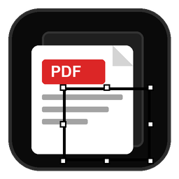

<div align="center">
  
  <h1>A-Crude-PDF-Editor (PDF Studio)</h1>
  <p>A lightweight, flat-black desktop PDF toolkit with interactive visual controls (Python backend + HTML5/Canvas frontend)</p>
  <p>
    <a href="./README.md">简体中文</a> | <strong>English</strong>
  </p>
</div>

---

## ✨ Features

### 1. Unified "PDF & Image Merge" Workspace
* **Flexible Mixed Merging**: Combines multi-PDF merging and image-to-PDF conversion in a single workspace. Merge multiple PDFs, convert images to a PDF, or **mix PDFs and images in any order** into one output PDF.
* **Grid Cards with Cover Thumbnails**: Uses Google PDFium to render the first page of each PDF as a cover preview and generates image thumbnails, arranged in a responsive tile grid showing order badges, page counts, and file sizes.
* **Fluid Drag-and-Drop Reordering (Pointer Events + FLIP Animation)**:
  * Replaces sluggish native HTML5 Drag & Drop with a custom Pointer Events engine featuring a floating ghost card, gap-free static slot hit-testing, and smooth FLIP layout animations.
  * Dragging any card shifts surrounding tiles in real time and updates order badges instantaneously. Includes edge auto-scrolling, `ESC` to cancel and revert a drag, `← / →` nudge controls, and animated filename sorting.
* **High-Resolution Preview Modal**: A **Preview** button sits at the bottom-right corner of every thumbnail; clicking it opens a full-screen lightbox displaying a high-res preview along with original image dimensions or PDF page count (dismiss via backdrop click or `ESC`).
* **Image Layout Controls**: Choose between original image dimensions, A4 Portrait/Landscape, or Letter page sizes, with configurable margins (`0` / `5` / `10` / `20 mm`) and resolution (`150` / `300 DPI`).

### 2. Visual Interactive "PDF Page Cropping"
* **Canvas Selection & 8-Handle Resizing**: Click and drag anywhere to draw a crop box, resize smoothly via 8 corner/edge handles, or drag inside the box to reposition, complete with rule-of-thirds guides and a pure black mask overlay.
* **Aspect Ratio Locks & Quick Margin Trim**: Lock selections to Free, `1:1`, `4:3`, `16:9`, A4 Portrait, or A4 Landscape, or trim `5%` / `10%` margins with one click.
* **Live Dimension HUD & Multi-Page Targeting**: Displays real-time selection dimensions in both points (`pt`) and millimeters (`mm`), with page navigation and scope selection (current page only, all pages, or custom page ranges such as `1, 3-5, 8`).
* **Lossless Cropping**: Modifies the standard PDF `CropBox` metadata directly without rasterizing pages, preserving vector graphics, selectable text, and original file size.

### 3. Desktop Drag & Drop & Flat-Black Minimalist UI
* **Direct Desktop Import**: Drag PDFs or images straight from your desktop or file explorer into the application window to import and auto-route them to the active workspace.
* **Pure Flat-Black Palette & Low Footprint**: Styled strictly with flat, gradient-free dark colors (`#000000` / `#121212`). Powered by `pywebview`, reusing Windows' built-in Edge WebView2 runtime instead of bundling Chromium for fast startup and modest RAM usage.

---

## 🛠️ Tech Stack

* **Desktop Shell**: `pywebview` (reuses system WebView2 runtime with native OS file dialogs)
* **PDF Manipulation**: `pypdf` (lossless merging & `CropBox` editing)
* **PDF Rendering**: `pypdfium2` (Google PDFium engine for fast page & thumbnail rendering)
* **Image Processing**: `Pillow` (PNG/JPG/WEBP/BMP/TIFF support, alpha compositing, paper layout scaling)
* **Frontend UI**: Vanilla HTML5 / CSS3 / JavaScript (Canvas cropping & Pointer Events + FLIP grid sorting)

---

## 📁 Project Structure

```text
A-Crude-PDF-Editor/
├── core/
│   ├── __init__.py
│   ├── image_merger.py     # Image-to-PDF layout & conversion engine
│   ├── pdf_cropper.py      # PDF rendering & lossless CropBox cropping
│   └── pdf_merger.py       # Mixed PDF/image merging, metadata & hi-res preview
├── gui/
│   ├── index.html          # UI layout & preview modal
│   ├── style.css           # Flat-black gradient-free stylesheet
│   └── app.js              # FLIP drag-sort engine, Canvas cropper & desktop drop
├── main.py                 # pywebview desktop entry point & Python-JS API bridge
├── icon.ico / icon.png     # Application icons
├── requirements.txt        # Python dependencies
├── README.md               # Chinese Documentation (Default)
└── README_EN.md            # English Documentation
```

---

## 🚀 Getting Started

### Prerequisites
* Python 3.10+ (Windows 10 / 11 recommended, with built-in Edge WebView2 runtime)

### 1. Clone & Install Dependencies
```bash
git clone https://github.com/Siesta666/A-Crude-PDF-Editor.git
cd A-Crude-PDF-Editor
pip install -r requirements.txt
```

### 2. Run the Application
```bash
python main.py
```

---

## 📦 Build Standalone Windows Executable (`.exe`)

To package the app into a standalone single-file `.exe` that runs without a Python installation:

```bash
pip install pyinstaller
pyinstaller --noconsole --onefile --icon="icon.ico" --add-data "gui;gui" --collect-all webview --name "PDF_Studio" main.py
```

The compiled executable will be generated at `dist/PDF_Studio.exe`.
